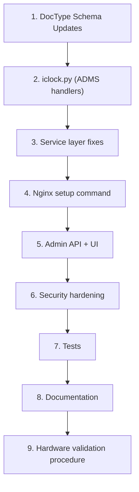

# Implementation Plan — eSSL Attendance (Generic Biometric Integration App)

## Design Goal

A **plug-and-play Frappe v16 app** for eSSL/ZKTeco biometric devices. When a new client needs integration:

1. `bench get-app essl_attendance` (already installed on the bench)
2. `bench --site <site> install-app essl_attendance`
3. Add Nginx config snippet (one-time per server, provided by bench command)
4. Register device in `Biometric Device` DocType
5. Create `Biometric User Mapping` records
6. Configure device to point to server → **Done**

---

## Architecture Decision: `/iclock/*` URL Routing

The K90 Pro firmware sends HTTP requests to `/iclock/cdata`, `/iclock/getrequest`, etc. Frappe only serves `/api/method/*` paths natively. 

**Solution: Nginx rewrite rules + Frappe API methods**

```
Device → HTTP → Nginx (/iclock/*) → rewrite → Frappe (/api/method/essl_attendance.iclock.*) → Handler
```

- The app provides a bench command `bench setup-iclock-nginx` to auto-generate the config
- One Nginx config covers ALL devices on that server
- No per-client Nginx changes needed

---

## File-by-File Change Plan

### Phase 1: Core ADMS Protocol (Critical Path)

#### 1.1 NEW: `essl_attendance/essl_attendance/iclock.py`
**Purpose**: All ADMS/iClock protocol handlers in one clean module

| Handler | Method | What it does |
|---|---|---|
| `cdata()` | GET+POST | Handshake (GET) + Attendance upload (POST) |
| `getrequest()` | GET | Heartbeat/command polling |
| `devicecmd()` | POST | Command execution feedback |

Key design:
- All methods are `@frappe.whitelist(allow_guest=True)` (required — device sends unauthenticated HTTP)
- Returns `werkzeug.wrappers.Response` with `text/plain` content type
- Validates device serial number on every request
- Parses tab-separated ATTLOG payload
- Stores raw punches, then processes asynchronously via `frappe.enqueue()`
- Rate-limited by IP via simple in-memory counter

#### 1.2 MODIFY: `essl_attendance/essl_attendance/hooks.py`
Changes:
- Keep existing scheduler hook
- Add `override_whitelisted_methods` if needed
- Remove the scheduler for push-mode devices (push handles itself)
- Add `after_install` and `before_uninstall` hooks

#### 1.3 NEW: `essl_attendance/essl_attendance/setup_nginx.py`
**Purpose**: Bench command to generate/install Nginx config

```
bench --site <site> setup-iclock-nginx
```

Generates:
```nginx
# /etc/nginx/conf.d/iclock_proxy.conf (or inline in site config)
location /iclock/cdata {
    rewrite ^(.*)$ /api/method/essl_attendance.iclock.cdata break;
    proxy_pass http://127.0.0.1:8000;
    proxy_set_header Host $host;
    proxy_set_header X-Real-IP $remote_addr;
    proxy_set_header X-Forwarded-For $proxy_add_x_forwarded_for;
    proxy_set_header X-Forwarded-Proto $scheme;
    proxy_read_timeout 30;
}
location /iclock/getrequest {
    rewrite ^(.*)$ /api/method/essl_attendance.iclock.getrequest break;
    proxy_pass http://127.0.0.1:8000;
    proxy_set_header Host $host;
    proxy_set_header X-Real-IP $remote_addr;
    proxy_set_header X-Forwarded-For $proxy_add_x_forwarded_for;
    proxy_set_header X-Forwarded-Proto $scheme;
}
location /iclock/devicecmd {
    rewrite ^(.*)$ /api/method/essl_attendance.iclock.devicecmd break;
    proxy_pass http://127.0.0.1:8000;
    proxy_set_header Host $host;
    proxy_set_header X-Real-IP $remote_addr;
    proxy_set_header X-Forwarded-For $proxy_add_x_forwarded_for;
    proxy_set_header X-Forwarded-Proto $scheme;
}
```

#### 1.4 MODIFY: `essl_attendance/essl_attendance/api.py`
- Remove old `receive_punch()` and `getrequest()` (replaced by `iclock.py`)
- Add authenticated admin API methods:
  - `test_device_connection(device_name)` — ping device (for TCP mode only)
  - `manual_sync(device_name)` — trigger sync for polling-mode devices
  - `reprocess_failed_punches(device_name)` — retry unmapped/failed raw punches
  - `get_device_status(device_name)` — return connection status, last heartbeat

---

### Phase 2: DocType Schema Improvements

#### 2.1 MODIFY: `biometric_device.json`
Add fields (via schema update):

| Field | Type | Purpose |
|---|---|---|
| `serial_number` | Data (unique, reqd) | **Make required** — needed for ADMS push |
| `device_timezone` | Link to Timezone or Data | Replace broken Select field |
| `last_heartbeat` | Datetime (read_only) | Track when device last pinged |
| `connection_status` | Select: Online/Offline/Unknown | Visual indicator |
| `last_error` | Small Text (read_only) | Last error message |
| `attlog_stamp` | Data (read_only, hidden) | ADMS stamp tracker |
| `operlog_stamp` | Data (read_only, hidden) | ADMS stamp tracker |
| `push_server_url` | Data (read_only) | Auto-computed URL to show admin what to configure on device |

Modify:
- `communication_type` options: `"ADMS Push\nTCP/IP (LAN Only)\nDummy Data (Testing)"`
- `time_zone`: Change to proper Select with timezone options, or use Data with description
- Add `autoname`: `field:device_name`
- Add missing DocType metadata: `engine`, `sort_field`, etc.
- Add Section Breaks for better form layout

#### 2.2 MODIFY: `biometric_device.py`
Add:
- Validation: serial_number required for ADMS Push mode
- Validation: serial_number uniqueness
- `push_server_url` auto-computation on save
- Method: `update_heartbeat()` — called by iclock handler
- Method: `update_connection_status()` — called by scheduler to mark offline devices
- Button handler: `test_connection` (for TCP mode)
- Button handler: `trigger_sync` (for TCP mode)

#### 2.3 MODIFY: `biometric_raw_punch.json`
Add fields:

| Field | Type | Purpose |
|---|---|---|
| `source_type` | Select: Push/Poll/Manual | How the punch was received |
| `raw_payload` | Small Text | Original line from device (for debugging) |
| `device_transaction_id` | Data | Device's own transaction ID if available |
| `received_at` | Datetime | When server received it |
| `idempotency_key` | Data (unique) | SHA256 hash for dedup |
| `processing_status` | Select: Pending/Processed/Failed/Unmapped | Replace boolean `processed` |

Modify:
- Keep `processed` for backward compat but deprecate
- Add proper `autoname: hash` or `autoname: naming_series`
- Add index on `idempotency_key`

#### 2.4 MODIFY: `biometric_raw_punch.py`
- Replace `before_insert` check-then-act with `idempotency_key` unique constraint
- Generate `idempotency_key` = SHA256(device + user_id + normalized_timestamp + punch_type)
- Add method: `retry_processing()` — attempt to create Employee Checkin again
- Add method: `mark_failed(error_msg)` / `mark_processed(checkin_name)`

#### 2.5 MODIFY: `biometric_sync_log.json`
Add fields:

| Field | Type | Purpose |
|---|---|---|
| `sync_type` | Select: Push/Poll/Manual/Reprocess | How sync was triggered |
| `failed_count` | Int | Records that failed processing |
| `error_details` | Long Text | Detailed per-record errors (sanitized) |

#### 2.6 MODIFY: `biometric_user_mapping.json`
Add fields:

| Field | Type | Purpose |
|---|---|---|
| `company` | Link: Company (fetch_from device) | For filtering |
| `employee_status` | Data (read_only, fetch_from) | Show if employee is Active |
| `biometric_user_name` | Data | Name as stored on device (informational) |

#### 2.7 MODIFY: `biometric_user_mapping.py`
Add validations:
- Employee must exist and be active (status = "Active")
- Employee must belong to the same company as the device
- Device must be enabled

---

### Phase 3: Service Layer Improvements

#### 3.1 MODIFY: `services/checkin_service.py`
- Return `(success: bool, checkin_name: str | None, error: str | None)` tuple
- Proper duplicate check using Employee Checkin's built-in dedup
- Timezone conversion: device_tz → server_tz
- Log type handling: configurable mapping (don't assume 0=IN, 1=OUT)
- Validate timestamp is not in the future (with tolerance)
- Validate timestamp is not unreasonably old

#### 3.2 MODIFY: `services/mapping_service.py`
- Add `get_employee_for_biometric_user()` — enhanced with device enabled check
- Add `get_unmapped_users(device_name)` — for admin dashboard
- Add `get_all_mappings(device_name)` — for admin
- Cache frequently accessed mappings (within request lifecycle)

#### 3.3 MODIFY: `services/sync_service.py`
- Add device-level Redis lock to prevent concurrent syncs
- Fix status logic: use Partial Success when some records fail
- Populate `error_count` and `error_details`
- Don't report connection failure as "0 records synced successfully"
- Remove per-record `frappe.db.commit()` — use batch commit
- Add `reprocess_unmapped_punches(device_name)` function
- Keep TCP polling for LAN-only scenarios

#### 3.4 MODIFY: `clients/k90_client.py`
- Add proper logging (replace silent exception swallowing)
- Add `force_udp=False` to ZK constructor
- Add connection timeout configuration
- Don't auto-connect in `get_attendance()` — require explicit connect
- Add `get_device_info()`, `get_serial_number()` methods

#### 3.5 MODIFY: `clients/dummy_client.py`
- Replace `print()` with `frappe.logger()`
- Add a flag to prevent accidental production use
- Generate predictable test data (seeded) for automated tests

#### 3.6 MODIFY: `clients/base_client.py`
- Add `get_device_info()` abstract method
- Add `get_serial_number()` abstract method
- Add type hints

---

### Phase 4: Admin Interface

#### 4.1 NEW: `essl_attendance/essl_attendance/essl_attendance/workspace/biometric_attendance/biometric_attendance.json`
Workspace with:
- Shortcuts to all 4 DocTypes
- Number cards: Total Devices, Online Devices, Today's Punches, Unmapped Punches
- Quick links: Reprocess Failed, View Sync Logs

#### 4.2 MODIFY: `biometric_device.json` (form layout)
- Add dashboard links (recent sync logs, raw punches, user mappings)
- Add connection info section with status indicator
- Add action buttons: Test Connection, Trigger Sync, View Setup Instructions

#### 4.3 NEW: `essl_attendance/essl_attendance/doctype/biometric_device/biometric_device.js`
Client script for:
- Test Connection button
- Trigger Sync button  
- Show setup instructions dialog (device config steps)
- Auto-refresh connection status

---

### Phase 5: Security Hardening

#### 5.1 In `iclock.py`
- Rate limit: max 100 requests/minute per IP (configurable)
- Payload size limit: max 1MB per request
- Timestamp validation: reject timestamps > 24h in future or > 30 days old
- Serial number format validation
- Sanitize all log output (no raw payloads in Error Log)
- Return generic error messages (no stack traces to device)

#### 5.2 In `api.py` (admin endpoints)
- All admin methods require `System Manager` or custom role
- Permission checks on device access
- Input validation on all parameters

#### 5.3 NEW: `essl_attendance/essl_attendance/permissions.py`
- Define custom roles if needed
- Permission hooks for DocTypes

---

### Phase 6: Testing

#### 6.1 NEW: `essl_attendance/essl_attendance/tests/test_iclock.py`
- Test GET /iclock/cdata (handshake) with valid/invalid SN
- Test POST /iclock/cdata (data upload) with valid ATTLOG data
- Test duplicate data handling
- Test malformed payloads
- Test rate limiting
- Test unknown device rejection

#### 6.2 NEW: `essl_attendance/essl_attendance/tests/test_checkin_service.py`
- Test valid checkin creation
- Test duplicate prevention
- Test timezone conversion
- Test invalid timestamps
- Test unmapped users

#### 6.3 NEW: `essl_attendance/essl_attendance/tests/test_sync_service.py`
- Test full sync cycle with DummyClient
- Test connection failure handling
- Test partial failure handling
- Test concurrent sync prevention

#### 6.4 NEW: `essl_attendance/essl_attendance/tests/test_mapping_service.py`
- Test valid mapping lookup
- Test inactive mapping
- Test disabled device
- Test disabled employee

---

### Phase 7: Documentation

#### 7.1 MODIFY: `README.md` — Complete rewrite
#### 7.2 NEW: `docs/architecture.md`
#### 7.3 NEW: `docs/device-protocol.md`
#### 7.4 NEW: `docs/deployment.md`
#### 7.5 NEW: `docs/troubleshooting.md`
#### 7.6 NEW: `docs/test-plan.md`

---

## Database Migration Strategy

All schema changes are additive (new fields, not removing existing ones). Frappe handles this automatically during `bench migrate`. No custom patches needed for field additions.

For the `idempotency_key` field on `Biometric Raw Punch`:
- Add a patch in `patches.txt` to backfill `idempotency_key` for existing records
- Add unique constraint after backfill

---

## New Dependencies

| Package | Purpose | Risk |
|---|---|---|
| None new | All functionality uses stdlib + frappe | No new deps |

> `pyzk` is kept as an optional dependency for TCP/IP mode. If not installed, TCP mode will show an error message. ADMS Push mode (the primary mode) requires NO external dependencies.

---

## Deployment Impact

| Area | Impact |
|---|---|
| **Nginx** | One-time config addition (automated via bench command) |
| **Database** | New fields auto-migrated by `bench migrate` |
| **Workers** | No changes — uses existing Frappe workers |
| **Scheduler** | Existing cron job kept for TCP polling mode |
| **Ports** | No new ports — uses existing port 80/443 via Nginx |
| **DNS** | No changes needed — uses existing site domain |

---

## Implementation Order



**Estimated files to create/modify: 25**
**Estimated lines of new code: ~2,500**
**Estimated time: Implementing now**

---

## New Client Setup Flow (After App is Built)

```
1. bench --site client-site.com install-app essl_attendance
2. bench --site client-site.com migrate
3. bench setup-iclock-nginx    (one-time per server)
4. sudo service nginx reload   (one-time per server)
5. In ERPNext: Create "Biometric Device" → Enter device serial number, company
6. In ERPNext: Create "Biometric User Mapping" → Map device user IDs to employees
7. On K90 Pro: Set Server Address = client-site.com, Port = 443, Enable HTTPS
8. Done ✅ — punches flow automatically
```
